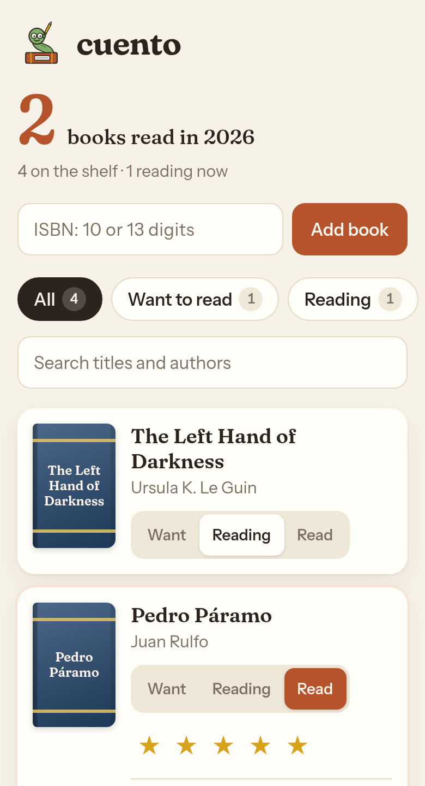
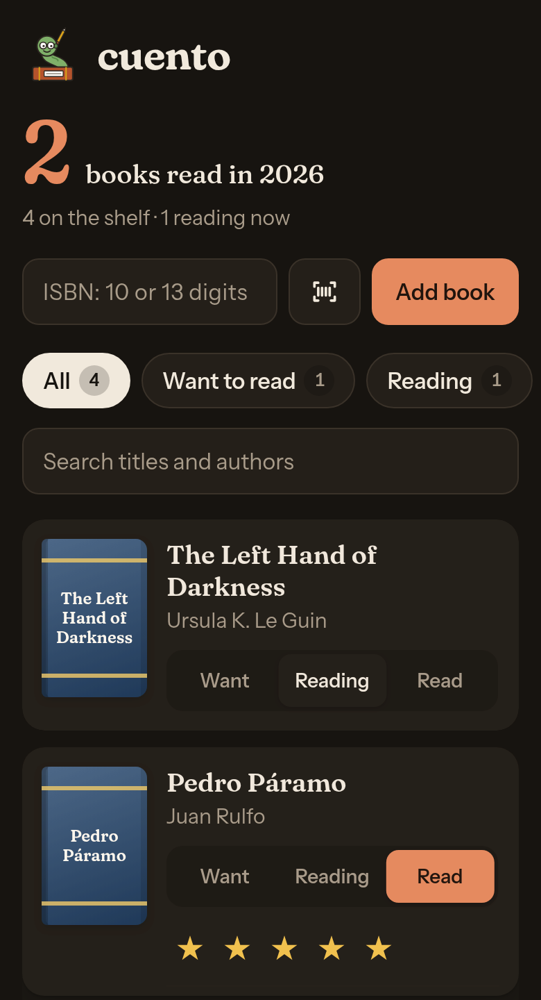

<p align="center">
  
</p>

cuento keeps the books you read. Type a book's ISBN (soon: scan its
barcode), and cuento finds its title, author and cover, and puts it on
your shelf: want to read, reading, or read, with the dates, a rating and
notes. It counts what you finished this year. It runs in the browser,
keeps your shelf on your device, and needs no account.

The name is Spanish: _un cuento_ is a story, and _cuento_ is also "I
count". The mascot is **Cuca**, a bookworm with round glasses and a
pencil behind her ear, for keeping count.

cuento is also the first real app on [spark](https://github.com/ldiaz94/spark),
a ~400-line reactive UI library: it is here to find spark's bugs (it
found one on its first day, fixed in spark 0.1.1).

## See it

<p align="center">
  
  
</p>

The pictures come from fixed books (`robbie shots`), so they show the app
as the tests see it.

## Get it

Open the deployed page, or run your own:

```sh
npm install           # TypeScript, Prettier, playwright-core: tools only
robbie build          # compiles src/ into build/site/
robbie serve          # http://localhost:8080/
robbie check          # types, unit tests, the page in headless Chromium
robbie deploy         # to Cloudflare, as static files
```

The browser tests drive Chromium at `/usr/sbin/chromium`; set `CHROMIUM`
for another.

## Learn it

| To                       | Do                                                             |
| ------------------------ | -------------------------------------------------------------- |
| Add a book               | Type its ISBN (10 or 13 digits, hyphens or not) and **Add**    |
| Add one no service knows | Add its ISBN, then its title and author by hand                |
| Start or finish a book   | Change its status: starting dates it, finishing dates it       |
| Rate a read book         | Tap a star; tap the same star again to clear it                |
| See its dates and notes  | Tap its title                                                  |
| Find a book              | Pick a status, or search titles and authors                    |
| Keep a copy              | **Export** saves the shelf as JSON; **Import** brings one back |

Your shelf lives in this browser only. On an iPhone, Safari may clear a
site's data after a few weeks unused: add cuento to your Home Screen,
and export now and then.

## How it works

Four ideas, a module each, read in this order:

1. **An ISBN is a check digit away from wrong** ([src/isbn.ts](src/isbn.ts)).
   Both lengths are checked, and every book is kept by its ISBN-13.
2. **Two services, and offline is not "no such book"**
   ([src/lookup.ts](src/lookup.ts)). Open Library first, Google Books
   when it has no record; a lookup that reached neither throws. Only
   `https:` cover URLs are kept, since spark does not sanitise attributes.
3. **The shelf is plain data** ([src/shelf.ts](src/shelf.ts)). A book is
   a record; a status brings its dates; the shelf is kept in
   `localStorage` and travels as an export file.
4. **The page is signals and templates** ([src/app.ts](src/app.ts)). The
   books are a signal; a computed filters and searches them; spark's keyed
   `each()` keeps one row per book, updated in place.

cuento is TypeScript, strict. `robbie build` compiles `src/` into
`build/site/`, beside `public/` (the page, its style and icon) and spark,
which `src/spark/` vendors at a tag (`robbie spark`) as JavaScript with
its own type declarations. The tests are TypeScript too, and Node runs
them as they are.

## Tests

`robbie check`: strict TypeScript over the app and the tests; the pure modules in Node
(check digits, the lookup's fallback and offline case, unsafe cover URLs,
status dates, imports, a full or broken storage); and the page in
headless Chromium with the services faked (adding, every note the ISBN
field gives, adding by hand, statuses and ratings, filters and search, a
reload, and that a book's title never becomes HTML).

## Left out

- **Scanning a barcode** and **working offline**: the next two steps.
- **Sync between devices**: export and import carry a shelf.
- **Editions, series and reading goals**: a book is one ISBN.

## Licence

ISC: see [LICENSE](LICENSE). spark, in `src/spark/`, is ISC too.
